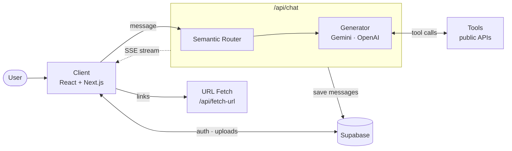

# Chat Agent

A multi-provider AI messenger built on Gemini and OpenAI. A LangGraph.js agent routes each message to web search, public-data tools, or one of 13 interactive renderers, and streams the answer back with numbered citations.

- **Two providers, one chat**: Gemini 3.8 / 3.6 Flash and GPT-6 luna / GPT-5.6 luna, switchable per conversation
- **Grounded answers**: web search with clickable `[N]` citations, decided per turn by a tiered search policy
- **Reads what you give it**: images, PDFs (including download links), video, YouTube, Office files, HWP/HWPX
- **Answers as cards**: drugs, pharmacies, hospitals, vets, laws, papers, movies, weather, chemistry, 3D proteins, charts and more
- **Read aloud**: streaming TTS for members

---

## Contents

1. [Features](#1-features)
2. [Architecture](#2-architecture)
3. [Tech Stack](#3-tech-stack)
4. [Getting Started](#4-getting-started)
5. [Project Structure](#5-project-structure)
6. [Documentation](#6-documentation)
7. [Operations](#7-operations)

---

## 1. Features

### 1-1. Conversation & Accounts

| Feature | Description |
| --- | --- |
| Guest or member | Start instantly as a guest (limited messages). Sign in for full limits, TTS, and the paid Gemini key |
| Sign-in | Google (in-app popup) and Kakao. A guest's conversations carry over to the new account → [REF_Auth](docs/guide/REF_Auth.md) |
| History | Sessions and messages stored in Supabase, auto-titled, loaded 30 at a time in the sidebar |
| Waiting state | A Thinking Orb with the current step ("문서를 분석하고 있어요…") until the first token arrives |
| Languages | Korean, English, Spanish, French |

### 1-2. AI

| Feature | Description |
| --- | --- |
| Models | **Gemini 3.6 Flash (default)**, Gemini 3.8 Flash, GPT-6 luna, GPT-5.6 luna. Gemini 3.7 (retiring 2027-01-28) is sent to 3.8. Older models (Gemini 3.5 / 2.5, GPT-5.4 mini) stay accepted for existing sessions but are hidden from the picker |
| Intent routing | A fast router model plus rule-based guards picks the path: web answer, tool card, renderer, or document Q&A |
| Web search | Turned on or off per turn by declared priority tiers — e.g. an explicit "search this" beats "the attached document already answers it" → [REF_SearchRouting](docs/guide/REF_SearchRouting.md) |
| Citations | Both providers' sources become clickable `[N]` markers and source chips. Unbacked `[N]` from the model is removed |
| Tools | Drug, pharmacy, hospital, vet, law, movie, paper (PubMed / arXiv) and weather lookups via function calling |
| Card follow-ups | Cards stay on screen; follow-up questions are answered from the card instead of redrawing it |
| Live facts | "Open now" for pharmacies and hospitals is computed by the server from official data, never guessed by the model |
| Documents | PDF, DOCX/PPTX/XLSX, HWP/HWPX, plus PDF download links. Follow-up questions are answered from the document → [REF_Document](docs/guide/REF_Document.md) |
| Media | Images, video, YouTube (captions or native video analysis) |
| Read aloud | Gemini 3.8 Flash Lite TTS with Gemini 3.8 Flash fallback, streamed so playback starts in about a second. Members only, 20,000 chars/day → [REF_TTS](docs/guide/REF_TTS.md) |

Routing, tool binding, model policy and streaming: [REF_Architecture](docs/guide/REF_Architecture.md)
Which intent a message should get (the rules behind the router tests and golden set): [REF_ROUTER_LABELS](docs/guide/REF_ROUTER_LABELS.md)

### 1-3. Renderers (13)

| Renderer | Shows | Data source |
| --- | --- | --- |
| 💊 Drug | Pill identification, drug info | MFDS pill DB + ConnectDI |
| 🏥 Pharmacy | Nearby pharmacies, open now | Public Data Portal pharmacy API |
| 🏨 Hospital | Hospitals, treatment hours, ER | HIRA hospital + detail services |
| 🐾 Vet | Animal hospitals | MOIS animal hospital service |
| ⚖️ Law | Statutes and articles | Korea Law Information Center API |
| 📄 Paper | Research papers | PubMed + CrossRef, arXiv |
| 🎬 Movie | Today's showtimes | Lotte / Megabox / CGV |
| 🌦️ Weather | Current + 5-day forecast | KMA (Korea), OpenWeather (global) |
| 🧪 Chemistry | 2D molecule structures | smiles-drawer |
| 🧬 Biology | 3D protein structures | NGL Viewer (PDB) |
| 📐 Physics | Diagrams | Canvas 2D |
| ✨ Astronomy | Constellations and sky maps | Canvas + astronomy-engine |
| 📊 Chart | 9 chart types | ApexCharts |

Per-renderer schemas and test prompts: [docs/guide/](docs/guide/README.md)

### 1-4. Performance & Security

- **Lighthouse**: Performance 91 · Best Practices 100 · CLS 0.00 — JS 365 KB gzip
- **Uploads**: presigned URLs, token required, files isolated per user by Storage RLS
- **URL fetching**: SSRF protection on every server-side fetch (IP checks, DNS answers, per-redirect re-check) → [DEV_261010](docs/logs/2026/10/DEV_261010.md)
- **Errors**: internal messages never reach the browser. Users see a localized notice; the original goes to server logs
- **Keys**: API key rotation with cooldown on 429 and blacklist on 401/403
- **TTS**: token required and a daily quota checked atomically before any paid call
- Open hardening items: [PLAN_HARDENING_260822](docs/plans/PLAN_HARDENING_260822.md)

---

## 2. Architecture



1. **Client** sends the message with history and any attachments; links are fetched first (HTML or PDF).
2. **Router** picks the intent and whether to search the web.
3. **Generator** answers with the selected model, calling tools (drug, hospital, law, weather…) when a card is needed.
4. The answer **streams back** and renders as text, citations, or a card.

Step-by-step diagrams (agent flow, URL fetch fallbacks, pill ID, DB/Storage, TTS): [REF_Architecture](docs/guide/REF_Architecture.md#요청-흐름-단계별-지도)

---

## 3. Tech Stack

| Layer | Technology |
| --- | --- |
| Frontend | React 19, Next.js 16 App Router, TypeScript, Tailwind CSS, Framer Motion |
| Markdown | react-markdown, remark-gfm, remark-math + rehype-katex |
| Visualization | ApexCharts, smiles-drawer, NGL Viewer, Canvas, astronomy-engine |
| Backend | Next.js Route Handlers on Vercel, LangGraph.js, LangChain |
| AI | Google GenAI SDK, OpenAI Responses API |
| Data | Supabase (PostgreSQL + Storage) → [REF_DB](docs/guide/REF_DB.md) |

---

## 4. Getting Started

### 4-1. Environment

```bash
cp .env.example .env.local   # then fill in each value
```

Field descriptions are in [.env.example](.env.example).

### 4-2. Database

For a new Supabase project, run every file in `docs/guide/db/` in this order. All scripts are idempotent.

| # | File | Creates |
| --- | --- | --- |
| 1 | `auth-mvp-schema.sql` | `profiles`, `chat_sessions`, `chat_messages` + RLS |
| 2 | `auth-mvp-storage-buckets.sql` | Upload buckets |
| 3 | `storage-user-prefix-rls.sql` | Per-user Storage policies |
| 4 | `url-cache.sql` | URL prefetch cache |
| 5 | `mfds-pills.sql` | Pill DB, then load it with `node docs/guide/db/sync-mfds-pills.mjs` |
| 6 | `tts-quota.sql` | TTS daily quota |
| 7 | `session-activity.sql` | Sidebar order by last message (trigger + one-time backfill) |

> ⚠️ Run steps 3 and 6 **before** deploying the app. Without them, uploads are rejected and TTS returns 500.

Details: [docs/guide/db/README.md](docs/guide/db/README.md)

### 4-3. Run

```bash
npm install
npm run dev      # http://localhost:3000
```

### 4-4. Verify

```bash
npm run verify   # strict typecheck + ESLint errors + knip + harnesses — run before every commit
npm test         # 36 harnesses, no network or secrets needed
```

Harness list and how to add one: [tests/README.md](tests/README.md)

`verify` runs four gates in order: `typecheck:strict` (`tsconfig.strict.json`, unused locals and parameters), `lint --quiet` (errors only; warnings stay visible), `lint:dead` (knip: unused files and exports, undeclared dependencies), then the harnesses. Build config (`tsconfig.json`) is unchanged, so `next build` is not affected.

---

## 5. Project Structure

```
├── app/
│   ├── page.tsx, layout.tsx
│   └── api/            # chat (SSE), fetch-url, speech, sessions, showtimes, parse-document,
│                       # create-signed-url, proxy-image, sync-drug-image, summarize-title, client-log
├── server/
│   ├── agent/          # LangGraph graph, router, generator, tools, search policy, prompts
│   ├── openai/         # OpenAI Responses adapter
│   ├── tts/            # TTS split, retry, synthesis
│   └── ...             # model registry, key rotation, SSRF guard, PDF detection
├── components/         # UI and the 13 renderers
├── src/
│   ├── hooks/          # useAuthSession, useChatSessions, useChatStream
│   └── lib/            # client model registry, loading status, error reporting
├── lib/ · utils/       # shared helpers (Supabase client, math normalization, streaming markdown)
├── services/           # client API layer
├── tests/              # regression harnesses (npm test); manual/ holds live-provider probes
├── docs/               # guides, plans, dated work logs, DB schema
└── data/               # theater branch list
```

`scripts/` is git-ignored and reserved for throwaway experiments against live APIs.

---

## 6. Documentation

Start at [docs/README.md](docs/README.md). Feature references are indexed in [docs/guide/README.md](docs/guide/README.md), and the changelog is [docs/DEV_HISTORY.md](docs/DEV_HISTORY.md).

| Folder | Contents | File name |
| --- | --- | --- |
| `docs/guide/` | Feature and renderer reference | `REF_<Topic>.md` |
| `docs/plans/` | Plans, designs, analyses | `PLAN_<TOPIC>[_YYMMDD].md` |
| `docs/logs/YYYY/MM/` | Dated work logs | `DEV_YYMMDD.md` |
| `docs/guide/db/` | DB schema SQL — the single source for environment setup | — |

Dates use `YYMMDD` (e.g. `261014` = 2026-10-14). A new work log also gets a line in `DEV_HISTORY.md` and the monthly index.

---

## 7. Operations

### Public API keys

All data.go.kr services share one account key (`PHARM_KEY`) but are approved per service, so an expired service breaks one card, not the whole app. Renew before:

| Service | Used by | Expires |
| --- | --- | --- |
| 전국 약국 정보 조회 | Pharmacy card | 2028-05-06 |
| 병원정보서비스 (`hospInfoServicev2`) | Hospital card | 2028-05-07 |
| 동물병원 조회서비스 | Vet card | 2028-05-10 |
| 의료기관별상세정보서비스 (`MadmDtlInfoService2.8`) | Hospital hours, ER | 2028-08-23 |

### Logs

Production builds strip `console.log/info/debug/warn`, server and client alike. Set `KEEP_LOGS=1` on Vercel and redeploy to diagnose, then remove it.
