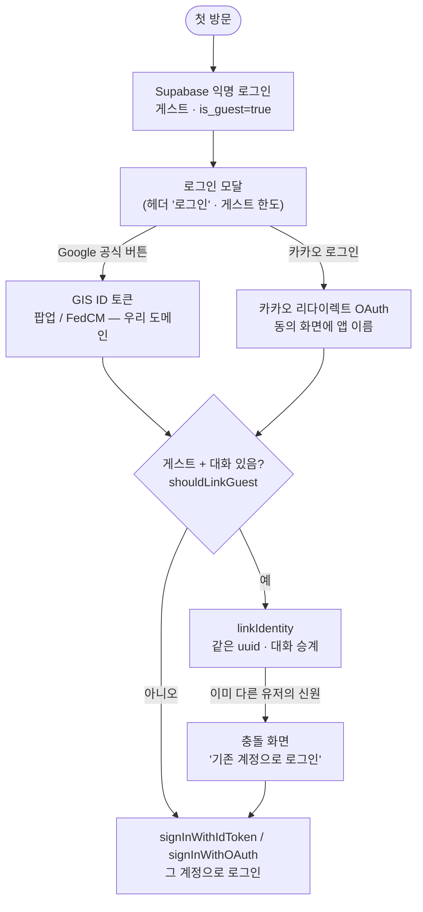

# REF: Auth — 게스트 · Google · 카카오

> 작성일: 2026-10-12 · 관련: [REF_DB](REF_DB.md)(테이블·RLS·트리거) · [DEV_261011 §5·§6](../logs/2026/10/DEV_261011.md) · [PLAN_AUTH_MVP_260709](../plans/PLAN_AUTH_MVP_260709.md)

현재 로그인 구조와 **외부 콘솔 설정**(Google Cloud · Supabase · Kakao Developers)을 한곳에 모은다.
콘솔 설정은 코드에 남지 않으므로 바꾸면 이 문서를 같이 고친다.

---

## 1. 구조 한눈에

| 단계 | 코드 |
|---|---|
| 게스트 생성·세션 보장 | [lib/supabase/client.ts](../../lib/supabase/client.ts) `ensureSession` · `consumeOAuthError` |
| 로그인·연결·로그아웃 | [src/hooks/useAuthSession.ts](../../src/hooks/useAuthSession.ts) |
| 모달 · Google 버튼 | [components/AuthModal.tsx](../../components/AuthModal.tsx) · [components/GoogleIdButton.tsx](../../components/GoogleIdButton.tsx) · [src/lib/google-id.ts](../../src/lib/google-id.ts) |
| link/signIn 판정 · 충돌 재시도 | [App.tsx](../../App.tsx) `shouldLinkGuest` · `onSignIn` |
| 프로필 이름·사진 | DB 트리거 — [REF_DB](REF_DB.md), [auth-mvp-schema.sql](db/auth-mvp-schema.sql), [auth-mvp-identity-sync.sql](db/auth-mvp-identity-sync.sql) |
| 하니스 | [tests/test-google-id.mts](../../tests/test-google-id.mts) (32건) |

## 2. 규칙

- **link 는 게스트에게만.** `shouldLinkGuest = is_guest && guestHasData`. `guestHasData` 는 정식 사용자에게도 참이라(자기 대화) 게스트 조건 없이 쓰면 **정식 계정에 다른 신원이 붙는다.**
  같은 이유로 "다른 계정으로 로그인" 버튼은 없다 — 로그아웃 → 새 게스트 → 모달에서 계정 선택(DEV_261011 §5).
- **충돌**(`identity_already_exists`): GIS 는 예외로, 리다이렉트는 돌아온 URL 의 `error_code` 로 온다.
  "기존 계정으로 로그인" 은 **시도한 공급자로** 간다 — GIS 는 받은 토큰 재사용(계정 재선택 없음), 리다이렉트는 `sessionStorage` 의 마지막 공급자(`lastOAuthProvider`).
- **로그인·로그아웃 뒤엔 새로고침**하되 주소의 `#access_token…` 을 버린다(`location.replace`). 리다이렉트(implicit) 로그인 뒤 토큰이 해시에 남고,
  그대로 `reload()` 하면 끝난 세션 토큰을 다시 싣는다(카카오 → 로그아웃 → Google 실패, 10-11). 세션 확보 직후에도 `stripAuthHash()`.
- **폴백**: `NEXT_PUBLIC_GOOGLE_CLIENT_ID` 가 없거나 GIS 스크립트가 막히면(6s) 기존 Google 리다이렉트 버튼. 로그인이 깨지지 않는다.

## 3. 공급자별

| | Google | 카카오 |
|---|---|---|
| 방식 | **GIS ID 토큰**(앱 안) → `signInWithIdToken` / `linkIdentity({ token, nonce })` | **리다이렉트 OAuth** → `signInWithOAuth` / `linkIdentity({ provider })` |
| 왜 | 리다이렉트면 계정 선택 화면에 **"…supabase.co(으)로 이동"** 이 뜬다 | 카카오 동의 화면엔 **앱 이름·아이콘**("Chat Agent")이 뜬다 — 바꿀 이유 없음 |
| nonce | Google 에 SHA-256 hex, Supabase 에 원문. Supabase "Skip nonce checks" **끔** | — |
| scopes | (GIS 기본) | `profile_nickname profile_image account_email` **명시** — 생략 시 사진이 안 왔다(10-11 실측) |
| 버튼 | 공식 GIS 버튼(`outline` 흰 단색, large pill 40px). 브라우저에 Google 로그인이 있으면 개인화("○○ 계정 사용") | 디자인 가이드 #FEE500 · 검정 말풍선 · "카카오 로그인" · 40px |
| 이메일 | 항상 | 비즈 앱 + `account_email` 필수 동의. `email_verified: true` 로 들어온다 |

## 4. 외부 설정 (현행)

### 4-1. Supabase — 두 프로젝트

| | dev | prod |
|---|---|---|
| ref | `ghdpnuwbvlrxmxcazzci` | `gaomgqnpsjtabrvwnpad` |
| 쓰는 곳 | `.env.local`(localhost) · `chat-agent-dev.vercel.app` | `chat-gem.vercel.app` |
| 콜백 | `https://ghdpnuwbvlrxmxcazzci.supabase.co/auth/v1/callback` | `https://gaomgqnpsjtabrvwnpad.supabase.co/auth/v1/callback` |

⚠️ 두 프로젝트가 **다른 Supabase 계정**에 있다. 콘솔 화면이 같아 착각하기 쉽다 — 항상 Callback URL 의 ref 로 확인한다.

Authentication → Providers:
- **Anonymous** 켬 · **Manual linking** 켬(게스트 → linkIdentity).
- **Google**: Client IDs = 아래 웹 클라이언트 · Client Secret(리다이렉트 폴백용) · **Skip nonce checks 끔** · Allow users without email 끔.
- **Kakao**: REST API Key · Client Secret Code(카카오 로그인 시크릿) · Allow users without an email **끔**. dev ✅, prod ⏳(main 반영 전 입력).

### 4-2. Google Cloud — 프로젝트 `Gemini-Model-Test`

- OAuth 클라이언트 **`chat-agent-web`**(웹), ID `486413513531-bq3th0te8hpdollo3q674meg6s6gvu5q.apps.googleusercontent.com` — **dev·prod 공용**.
- 승인된 JavaScript 원본: `http://localhost:3000` · `https://chat-agent-dev.vercel.app` · `https://chat-gem.vercel.app` (GIS 필수. 로컬은 `127.0.0.1` 이 아니라 `localhost`).
- 승인된 리디렉션 URI: 위 두 Supabase 콜백(리다이렉트 폴백).
- 브랜딩(앱 이름·로고)·브랜드 인증: 미완 — 팝업에 앱 이름을 띄우려면 필요.

### 4-3. Kakao Developers — 앱 **Chat Agent**(ID 1604228) 하나로 dev·prod 공용

| 메뉴 | 설정 |
|---|---|
| 앱 → 일반 | 앱 이름 Chat Agent · 아이콘 · 회사명 `jpjp92` · 카테고리 · 대표 도메인(임시 dev — prod 전환 시 `https://chat-gem.vercel.app`) |
| 비즈니스 인증 | **개인 개발자 비즈 앱**(본인인증) — 이메일 필수 동의에 필요. `biz_account_email` 항목은 쓰지 않음 |
| 카카오 로그인 → 일반 | 사용 설정 **ON** · OpenID Connect **OFF**(리다이렉트라 불필요) |
| 카카오 로그인 → 동의항목 | 닉네임 `profile_nickname` **필수** · 프로필 사진 `profile_image` **선택** · 카카오계정(이메일) `account_email` **필수[수집]** |
| 카카오 로그인 → 고급 | 로그아웃 리다이렉트 URI 없음(카카오 동반 로그아웃 미사용) · 사용자 아이디 고정 기본값 |
| 앱 → 플랫폼 키 → **Default Rest API Key** 수정 | 카카오 로그인 리다이렉트 URI = **두 Supabase 콜백**(입력 후 **＋ 로 추가 → 저장**) · 호출 허용 IP **비움**(Supabase 서버 IP 비고정) · 클라이언트 시크릿 **카카오 로그인 ON** · 비즈니스 인증 OFF |
| 웹훅(연결 해제) | 미설정 — 탈퇴 연동과 함께 후속 |

테스트 앱 Chat Agent-TEST(1604375)는 만들었지만 쓰지 않는다. 처음엔 dev 용으로 나누려 했으나 설정이 전부 원본 앱에 들어갔고, dev 콜백 미등록으로 **KOE006** 이 났다 →
원본 앱에 dev 콜백을 추가해 공용으로 정리. 오류 화면의 앱 이름과 URL 의 `client_id` 로 어느 앱인지 가린다.

### 4-4. 환경 변수 · 헤더

- `NEXT_PUBLIC_GOOGLE_CLIENT_ID` — `.env.local` · Vercel(dev ✅ · prod ⏳). Type **Config**(공개 값 — Secret 으로 두면 `NEXT_PUBLIC_` 경고). 빌드 타임 값이라 등록 후 재배포.
- CSP `frame-src` 에 `https://accounts.google.com`(GIS 버튼 iframe) — [next.config.ts](../../next.config.ts).

## 5. 오류 · 진단

| 증상 | 원인 |
|---|---|
| `validation_failed: Unsupported provider: provider is not enabled` | 그 Supabase 프로젝트에서 공급자가 꺼짐(다른 프로젝트에만 설정) |
| 카카오 **KOE006** | 리다이렉트 URI 미등록 — 원본 앱 REST API 키에 그 Supabase 콜백 |
| 카카오 KOE205 | 요청한 동의항목이 설정되지 않음 |
| 카카오 사진 없음 | scopes 미명시 — identity_data 에 `avatar_url`·`picture` 가 있는지 dev DB 로 확인 |
| Google `origin_mismatch` | 승인된 JavaScript 원본에 그 주소 없음 |
| `FedCM get() rejects with NetworkError` | VS Code 내장 브라우저 등 FedCM 불완전 환경 — 일반 Chrome 에선 정상 |
| 로그인 후 다른 계정으로 돌아옴 | 주소의 `#access_token` 재사용 — §2 해시 제거가 빠졌는지 |

## 6. 남은 것

- [ ] 게스트(대화 있음) → 카카오 연결 → 대화 유지 · 이미 쓰는 카카오 → 충돌 → 카카오로 재로그인
- [ ] 같은 이메일의 Google·카카오 자동 연결 여부(카카오 `email_verified: true`) — 갈리면 정책 결정
- [ ] prod: Supabase Kakao 입력 · Vercel `chat-gem` env · 카카오 대표 도메인
- [ ] 카카오 연결 해제 웹훅 · Google 브랜드 인증
