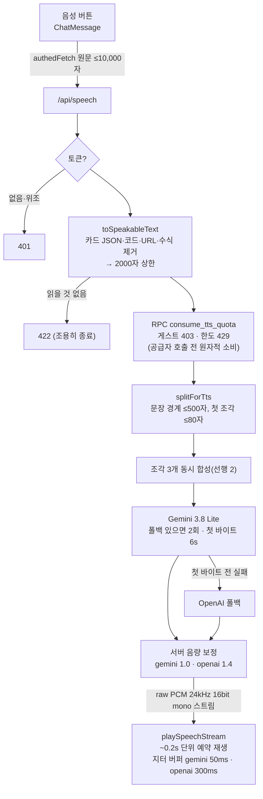

# REF: TTS (소리 내어 읽기)

> 최종 점검: 2026-10-20(폴백 교체) · 상태: **dev 구현, main 미배포**
> 설계·측정 이력: [PLAN_TTS_STREAMING_261002](../plans/PLAN_TTS_STREAMING_261002.md) · 날짜 로그: [DEV_261003](../logs/2026/10/DEV_261003.md)
> 코드: `app/api/speech/route.ts` · `server/tts/` · `lib/tts-speakable.ts`(서버·클라 공용) · `services/geminiService.ts`(`playSpeechStream`) · `components/ChatMessage.tsx`

---

## 1. 모델 정책

| 순위 | 모델 | 언제 |
|---|---|---|
| **1순위** | Gemini `gemini-3.8-flash-lite-tts` (음성 `Kore`) | 기본 |
| **폴백** | Gemini `gemini-3.8-flash-tts` (음성 `Kore`) | 1순위가 **조각의 첫 바이트 전**에 실패할 때. `TTS_FALLBACK=off` 로 끈다 |

- 폴백을 다른 모델로 두는 이유: Gemini 한도는 모델 단위라 Lite 가 429·장애일 때 Flash 는 대개 살아 있다. **Google 전체 장애는 못 막는다.**
- 2026-10-20 까지 폴백은 OpenAI `gpt-4o-mini-tts` 였다. 이 모델은 **2027-01-06 API 에서 제거**된다. 공식 대체 `gpt-realtime-2.1-mini` 는 실측에서 날짜를 바꿔 읽었다("일월"→"2월" 3/3) → 교체([PLAN §10-2](../plans/PLAN_TTS_STREAMING_261002.md)). `TTS_PROVIDER`·`OPENAI_API_TTS` 는 더 쓰지 않는다.
- 2.5·3.1 TTS 는 2026-11-17 종료. 3.8 두 모델은 종료일 미발표(2026-10-20 확인).
- ⚖️ 채팅은 쿼터·장애를 다른 모델로 넘기지 않는다([REF_Architecture §Model Policy](REF_Architecture.md#model-policy)). TTS 는 **읽을 내용이 같고 목소리만 바뀌므로** 폴백을 허용한다(지금은 음성도 같다).

### 모델 선택 근거 (실측, 2026-10-02~04)

| 모델 | 2000자 첫 소리 | 2000자 생성 시간 | 문장 누락 | 비고 |
|---|---|---|---|---|
| **Gemini 3.8 Flash Lite TTS** | 1.2~1.4s | **28~30s** | 0/5 | 채택(1순위) |
| Gemini 3.8 Flash TTS | 1.5~1.7s | 54~55s | 0/5 · 283자 원문 9/9 | **채택(폴백, 10-20)** — 느리지만 생성이 재생보다 빠르다(40s 오디오를 11s) |
| OpenAI `gpt-4o-mini-tts` | 0.6~1.4s | 22~27s | 0/7 | 10-20 까지 폴백 — 2027-01-06 제거 |
| Gemini 3.1 Flash TTS (preview) | 0.9~1.5s | 37~41s | **1/7** | 2026-10-03~04 잠시 사용 후 교체 |
| Gemini 2.5 Flash TTS | = 전체 시간 | — | — | 🔴 stream 호출도 **한 덩어리**, 2000자 0/2 실패 — 2026-10-02 까지의 원래 모델 |
| `gpt-realtime-2.1-mini` | 2.0~2.7s(283자) | — | 🔴 날짜를 바꿔 읽음 | 미채택 — 대화 모델, WebSocket 세션 (PLAN §10-2) |

문장 누락은 약 340자(2조각)를 반복 합성해 **전사로 원문 문장을 대조**했다. 오디오 길이(±3%)로는 한 문장 누락을 못 잡는다.

---

## 2. 비용

오디오 출력이 비용의 대부분이고 **오디오 길이에 비례**한다(25 토큰/초 = 1,500 토큰/분). 한국어 ≈ 13.6초/100자.

| 모델 | 오디오 출력 단가 | 분당 | 보통 답변(300~500자, ≈1분) | 최대 2000자(≈4.7분) |
|---|---|---|---|---|
| **Gemini 3.8 Flash Lite TTS** | **$6/1M** (2026-12-31 까지) | ≈$0.009 | ≈$0.009 | **≈$0.04** |
| ↳ 2027-01-01 부터 | $12/1M (2배) | ≈$0.018 | ≈$0.018 | ≈$0.08 |
| Gemini 3.8 Flash TTS (폴백) | $9/1M (2026-12-31 까지) | ≈$0.0135 | ≈$0.0135 | ≈$0.06 |
| ↳ 2027-01-01 부터 | $18/1M (2배) | ≈$0.027 | ≈$0.027 | ≈$0.13 |

- 단가는 [Gemini 가격표](https://ai.google.dev/gemini-api/docs/pricing)(2026-10-20 확인). 다른 후보와의 비교는 [PLAN §10-1](../plans/PLAN_TTS_STREAMING_261002.md).
- **회원 한도 20,000자/일** = 2000자 10회 ≈ Lite **$0.4/일/회원**(2027 $0.8), 폴백으로만 읽으면 ≈$0.6(2027 $1.3).
- 월 상한: AI Studio **Project Spend Cap**(반영 ~10분 지연). 권장 $10~20/월.

---

## 3. 흐름

| 규칙 | 값 | 이유 |
|---|---|---|
| 조각 상한 | 500자 | 한 요청 ~800자를 넘으면 두 공급자 모두 **중간을 건너뛰거나 반복**(끝은 읽음). 700자도 OpenAI 2/4 생략, 500자 8/8 정상 |
| 첫 조각 | ≤80자 | 첫 소리를 당긴다 |
| 선행(prefetch) | 2 | 전체 시간 최소(p1 대비 ~절반) |
| 재시도 | **뒤에 폴백이 있으면 2회·첫 바이트 6s**, 마지막 공급자는 3회·12s. 모두 **첫 바이트 전에만** | 오디오를 낸 뒤 재시도하면 앞부분이 두 번 나온다. 영구 4xx·사용자 취소는 재시도 안 함 |
| 첫 바이트 타임아웃 | 6s(폴백 전) · 12s(마지막) | 응답 없이 걸린 시도를 60s 까지 기다려 61초 뒤 500 이 났다. 3회·12s 로도 폴백까지 ~37s 라 "너무 길다" → 걸린 Gemini 실측 **14.3s 에 OpenAI 첫 소리**(2026-10-04) |
| 폴백 | 첫 조각 실패 → 요청 전체 / 이후 조각 실패 → 그 조각만 | 목소리 하나 유지 vs 내용 누락 방지 |
| 이후 조각 최종 실패 | 건너뛰고 계속 | 한 조각을 잃는 편이 나머지 전부를 잃는 것보다 낫다 |
| 음량 | 서버 PCM 보정 | 3.8 Lite 원음이 풀스케일(피크 32768) — 예전 1.8 증폭이 찌그러뜨렸다. OpenAI 는 3.3dB 작다 |
| 다시 듣기 | 브라우저 메모리 캐시(총 64MB, LRU) | 같은 답변을 다시 누르면 서버 호출 없이 즉시 재생 — 비용·회원 한도 재차감 없음. **끝까지 받은 재생만** 저장(중단·끊김은 저장 안 함). 새로고침하면 사라진다 |
| 읽을 글 없음 | 클라이언트 사전 판정 | 카드·코드만 있는 답변은 서버를 부르지 않고 "읽을 글이 없습니다" 안내(서버 422 는 안전망) |
| 응답 크기 | 2000자 ≈ 13MB | 스트리밍이라 Vercel 4.5MB 응답 제한 대상 아님 |

---

## 4. 인증·한도

| 대상 | 결과 |
|---|---|
| 토큰 없음·위조 | 401 — 공급자 호출 0회(실측) |
| 게스트(익명) | 403 |
| 회원 | **20,000자/일**(KST 자정 리셋). 초과 429 |

- RPC `consume_tts_quota` — [tts-quota.sql](db/tts-quota.sql). 테이블 `tts_usage` 는 RLS on·정책 없음(사용자 읽기·쓰기 불가), 한도는 함수 상수.
- 한도는 **합성 전에** 소비한다 — 합성이 실패해도 차감된다(보수적).
- RPC 가 없으면 TTS 를 부르지 않는다(fail-closed) → 🔴 **새 DB 에는 SQL 적용 후 배포.** 현재 dev DB(poc-test)만 적용, main DB 미적용.

---

## 5. 오류 처리 — 사용자에게 코드·원문을 보이지 않는다

| 상황 | 서버 응답 | 사용자 안내(ko, 4개 언어) |
|---|---|---|
| 게스트 | 403 `Members only` | 음성 읽기는 로그인한 회원만 사용할 수 있습니다. |
| 한도 초과 | 429 `Daily limit reached` | 오늘 음성 읽기 한도를 모두 사용했습니다. 내일 다시 이용해주세요. |
| 세션 만료 | 401 | 로그인이 만료되었습니다. 다시 로그인한 뒤 시도해주세요. |
| 서버 미도달 | — | 네트워크 연결이 불안정합니다. 연결을 확인한 뒤 다시 시도해주세요. |
| 두 공급자 모두 실패 등 | 500 `Failed to generate speech` | 음성을 만들지 못했습니다. 잠시 후 다시 시도해주세요. |
| 카드·코드만 있는 답변 | (호출 안 함) · 422 | 이 답변에는 소리 내어 읽을 글이 없습니다. (카드·코드만 있는 답변) |
| 사용자 중지 · 재생 중 끊김 | — | 안내 없음(끊김은 받은 만큼 재생) |

- 공급자 원문(Gemini SDK JSON, OpenAI 응답 본문)은 **서버 로그(`console.warn/error`)에만** 남는다. 실측(2026-10-04): Gemini 무효 키 + 폴백 끔, 두 공급자 모두 무효 키 → 응답 본문 `{"error":"Failed to generate speech"}` 만.
- 클라이언트는 `TtsError(kind)` 로 분류하고 원인은 `console.warn` 에만 남긴다(`console.error` 는 dev 오버레이에 원문을 띄운다).

---

## 6. 환경 변수

| 변수 | 값 | 설명 |
|---|---|---|
| `TTS_FALLBACK` | `off` | 폴백(3.8 Flash) 끄기. 미설정이면 켜짐 |
| `TTS_USE_TIER1` | `true` | Gemini 를 유료 `API_KEY_TIER1` 로만. 미설정이면 무료 풀 `API_KEY`~`API_KEY12` 로테이션(한도가 작다) |
| `API_KEY_TIER1` | Gemini 유료 키 | 위와 짝 |

Vercel(2026-10-04): Production 에 `TTS_USE_TIER1`·`API_KEY_TIER1` 등록. Preview 는 Gemini 무료 풀(폴백도 같은 풀).
`OPENAI_API_TTS` 는 10-20 교체 뒤 쓰지 않는다 — 배포 후 env 에서 지워도 된다.

---

## 7. 검증

| 종류 | 위치 |
|---|---|
| 오프라인 하니스(`npm test`) | `tests/test-tts-split.mts` · `test-tts-retry.mts`(빠른 넘김 2회 포함) · `test-tts-speakable.mts` |
| 수동 프로브(유료) | `tests/manual/probe-tts-latency.mts` · `probe-tts-chunking.mts` · `probe-speech-route.mts`(회원 토큰 `TTS_PROBE_BEARER`) — [tests/README](../../tests/README.md) |

## 8. 남은 것

- 🔴 2026-12 안에 폴백을 `gemini-3.8-flash-tts` 로 교체(OpenAI 2027-01-06 제거)
- main DB 에 `tts-quota.sql` 적용 후 main 배포
- 귀로 확인: 조각 경계 · 음량 균형 · iOS Safari · 음성 후보 비교
- 말하기 속도 조절(미구현) · 실패 시 한도 환불(미구현 — 합성 전에 차감) · 라우트 회귀 하니스(인증·한도·오류 노출, 지금은 수동 확인)
